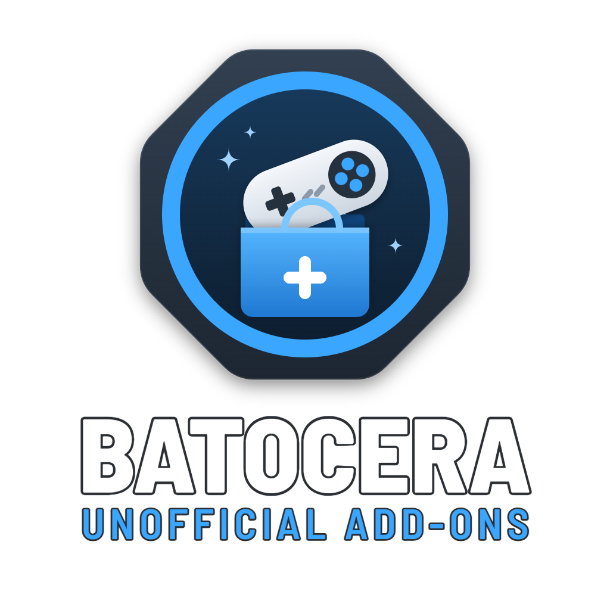

<p align="center">
  <picture>
    <source media="(prefers-color-scheme: light)" srcset="app/extra/batocera-unofficial-addons-light.png">
    
  </picture>
</p>

# Unofficial Add-ons for Batocera

   

---

**Unofficial add-ons for Batocera, in no way affiliated with the Batocera development team! Install at your own risk.**  
**You will find no support in the official Discord—better to ask for support in our own Discord!**

**Contributions welcome — please provide evidence of your addition working to speed up the process.**

---

## 🚀 Installation

```bash
curl -L install.batoaddons.app | bash
```

Individual install links won't be provided — the app is needed to handle dependencies. Install the app with the above command, then navigate the menus to find the app you want to install.

---

## 📜 Licensing & GPL Compliance

This repository is licensed under the **GNU General Public License v3.0 (GPL-3.0)**.  
A copy of the license is included in the [LICENSE](./LICENSE) file.

In accordance with the GPL:

- You are free to **use, modify, and distribute** this software.
- The **full source code** is available in this repository, including any installation scripts and helper files.
- If you distribute modified versions, you must also make the source available under the same license.
- Any GPL third-party software used or installed will retain its original license.
- Attribution is not required, since it is not a term of the GPL-3.0 license.

---

## 🧠 Resources

- **[Batocera Unofficial Add-Ons Wiki](https://wiki.batoaddons.app)** – Guides and support info
- **[Batocera Unofficial Add-Ons Discord](https://discord.gg/Uc9BVbDH9e)** – Community support

---
## 🙏 Special Thanks

This project wouldn't be possible without the passion, creativity, and collaboration of the retro and open-source communities.

Special thanks to:

🧠 **Uureel** — for sparking the original idea behind this project and providing access to several apps used within it.

🛠️ **IVAN-HC** — for providing AppImage builds used in the add-on collection.

📦 **ruanformigoni** — for creating FlatImage, which made Steam and Lutris integration possible.

📼 **VHSGunzo** - for creating RunImage, which provides the framework for some of the add-ons included.

🍷 **Gregoryc** — for developing and sharing the Wine Manager used in the system.

🎮 **Foclabroc** — for providing the Switch emulation tools that power part of the experience.

🎥 **[KevoBato](https://www.youtube.com/@KevsBatoceraBuilds)** — for his continued support, friendship, and awesome guide videos that help users get the most out of the project.

🤝 **All contributors** — for stepping up, submitting fixes, and helping ease the load — this wouldn’t scale without you.

👾 **The Batocera team** — for building the platform that started it all.

🧪 **Our community testers** — for pushing the limits and breaking things so I can fix them.

💬 **The Batocera Unofficial Add-Ons Discord** — for the feedback, the chaos, and the good vibes.

☕ **And you** — for keeping the flame of retro gaming alive with style.

---
## 💖 Supporters

Batocera Unofficial Add-ons is free and open source. If you find it useful, consider supporting development.

<p align="center">
  <a href="https://github.com/sponsors/batocera-unofficial-addons"></a>
</p>

<p align="center">
  
</p>

---
## 👥 Contributors

Thank you to everyone who has helped make Batocera Unofficial Add-ons better!

<p align="center">
  
</p>

---
## 💬 Disclaimer

This is a community project and is not affiliated with the official Batocera team.  
Use at your own discretion. For help, join the community Discord.

## Star History

<a href="https://www.star-history.com/?repos=batocera-unofficial-addons%2Fbatocera-unofficial-addons&type=date&legend=top-left">
 <picture>
   <source media="(prefers-color-scheme: dark)" srcset="https://api.star-history.com/chart?repos=batocera-unofficial-addons/batocera-unofficial-addons&type=date&theme=dark&legend=top-left" />
   <source media="(prefers-color-scheme: light)" srcset="https://api.star-history.com/chart?repos=batocera-unofficial-addons/batocera-unofficial-addons&type=date&legend=top-left" />
   
 </picture>
</a>

                    
